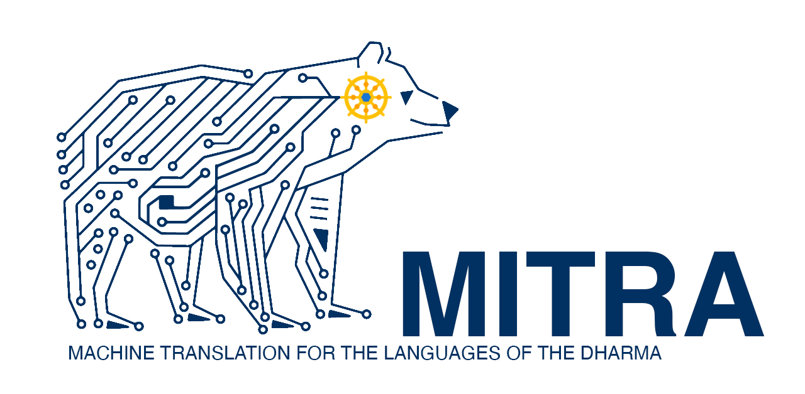

# DharmaMitra Agent Starterpack

Download this folder, open it in Claude Code, and you get a working setup for:

1. **Translating classical Asian Buddhist texts** (Tibetan, Chinese, Pali, Sanskrit → English / German / …) via DharmaMitra's multi-witness translation API, with your reference glossaries and prior translations threaded into every call.
2. **Critical-edition / philological work** — cross-language parallel retrieval to surface variant readings, propose emendations, and assemble an apparatus.
3. **Intertextuality research** — map how a text relates to the rest of the canon via DharmaNexus: which works quote, share, or rework it, and where its passages travel across collections and languages.

No DharmaMitra account or API key required. Endpoints are public.

## Setup

**With git:**

```bash
git clone https://github.com/dharmamitra/dharmamitra-claude-code-agent.git
cd dharmamitra-claude-code-agent
```

**Without git** — download the ZIP from the repo page (green **Code** button → **Download ZIP**), then unzip and `cd` into `dharmamitra-claude-code-agent-main`. Or in one line:

```bash
curl -LO https://github.com/dharmamitra/dharmamitra-claude-code-agent/archive/refs/heads/main.zip && unzip main.zip && cd dharmamitra-claude-code-agent-main
```

Then run `claude` in the folder.

Requires: `jq` (`brew install jq` / `apt install jq`), `python3`, and Claude Code. Optional for binary references: `pandoc` + `poppler` (`brew install pandoc poppler`).

On first launch, Claude builds a local index of the entire DharmaNexus corpus map (used for offline text identification) — this happens automatically via a `SessionStart` hook and takes a few seconds. You can also build/refresh it manually with `./scripts/setup.sh` (or `./scripts/setup.sh --force`).

## Translating a text

1. Drop source(s) under `sources/`, using language suffixes for multi-witness texts:
   ```
   sources/vajracchedika.sa.txt
   sources/vajracchedika.bo.txt
   ```
2. Drop glossaries, style guides, or any existing translations of this work under `references/`. Plain text, Markdown, DOCX, and PDF all work.
3. Run `/translate sources/vajracchedika` in Claude.

Claude chunks the source into 3–5-sentence units and calls `cat-translate` iteratively, writing to `output/translations/vajracchedika.md`. Each call's `context` field carries forward the prior translated chunks of this document plus the relevant glossary lines, so terminology and voice stay consistent across long texts. Claude pauses every ~5 chunks for you to adjust terminology; corrections you write into the brief are picked up on the next chunk.

If you've already translated chapters 1–3 elsewhere and want Claude to continue with chapter 4, drop that prior translation under `references/` — it'll be woven into the context for every call.

## Translating with your own agent (research recipe)

`/research-translate sources/<work>.bo.txt` has the agent running your session translate the text itself.
DharmaMitra's APIs serve as its research tools, not as the translator. This works with whatever model you run.

Before translating each paragraph, the agent researches it with two tools, each with its own budget:

- **up to 3 search calls**: BM25 search over the canonical corpus. Each hit comes back with the published English translation of that passage where one is aligned (84000, Tsadra, …) and its parallels in the other canon languages.
- **up to 3 dictionary calls**: MITRA dictionary entries built from word alignments of published translations: senses, attested renderings with counts, usage notes.

Each call is a batch of queries or words. This is the setting that came out best in our paragraph benchmark (Tibetan, Sanskrit and Chinese → English, judged pairwise against published translations), well ahead of translating without research.

**Better results with Gemini:** add `--engine gemini` (and set `GEMINI_API_KEY`, free at https://aistudio.google.com/apikey) to have Gemini 3.8 Flash do the research and translation, through `./scripts/gemini-translate.py`, with the same tools and budgets. In our Tibetan benchmark, Gemini 3.8 Flash at high thinking beat Claude Opus at high effort 25 to 13 in this setting (Gemini judge). Both recipes show this notice when they start.

The output goes to `output/translations/<work>.research.md`, one section per paragraph: the source, the translation, and a short note on what the research settled. The tools are `./scripts/research.py search|dict|budget` (Python standard library only), so any agent that can run shell commands can follow the same recipe from `.claude/agents/research-translator.md`.

## Translating a whole document (document recipe)

`/document-translate sources/<work>.bo.txt` is the scholarly version for whole texts. It combines the per-paragraph research loop above (3 search + 3 dictionary calls per chunk) with document-level procedure, following Kurt Keutzer's revised translation instructions:
- **Context carried between chunks:** the two previous chunks, the outline heading, and a project glossary that grows as the text proceeds.
- **Analysis before rendering:** unit type, quotation boundaries, and a short parse of each sentence, written to a working file before the English.
- **Checks:** a completeness check on every chunk, and an independent reviewer subagent on the harder chunks.
- **Notes for the human reviser:** fixed footnote categories (G V D Q L U), and ⟦?⟧ markers on uncertain sentences.
- **Effort tiers:** set from observable signals such as verse, debate, ambiguous parses and unresolved terms.

Put an existing glossary, conventions, prior translations, commentaries or an outline under `references/<work>/`. The output goes to `output/documents/<work>/`: the translation (plus .docx if `pandoc` is installed), `glossary.md`, `work/chunk-NNN.md` working files, and a `summary.md` that lists the chunks a human should read first.

## Building a critical apparatus

1. Put the anchor passage in `sources/`, or paste it inline.
2. Run `/critical-edition sources/passage.sa.txt`.

Claude retrieves parallels via `/primary/` (semantic search across all canon languages, `max_depth: 30`, ranking disabled), triages canonical vs. commentary citations, compares each witness against the anchor, and writes a structured apparatus to `output/critical-editions/<work>.md` with `src_link`s back to the DharmaMitra reading room for every citation.

## Mapping a text's intertextuality

1. Run `/intertextuality <title, author, or description>` — e.g. `/intertextuality Yaśomitra's Abhidharmakośa commentary`.

Claude resolves the description to a DharmaNexus text via the offline matcher, then uses DharmaNexus's intertextuality layer to find every precomputed overlap between that text and the rest of the corpus: which works it shares material with (and how much), where individual verses travel across collections, and which parallels are cross-language transmissions. It writes a structured report to `output/intertextuality/<work>.md`. Where philology drills *into* a passage, this maps *outward* from a whole text — the two hand off to each other at the variants they uncover.

## Other commands

- `/find-parallels <text>` — search the corpus for parallels of a given passage or phrase.
- `/lookup-segment <segmentnr>` — fetch one canonical passage by ID, e.g. `BO_K01_D0006:42b-3`.
- `/identify-text <title / author / topic>` — resolve a human description to a DharmaNexus corpus filename (offline, fuzzy).

## Folder layout

```
.
├── CLAUDE.md                    # project context — read first by Claude
├── .claude/
│   ├── settings.json            # allowlist + SessionStart hook that builds the corpus index
│   ├── agents/                  # translator, research-translator, document-translator, philologist, intertextual-researcher, corpus-searcher, reference-reader
│   └── commands/                # /translate, /research-translate, /document-translate, /find-parallels, /critical-edition, /intertextuality, /identify-text, /lookup-segment
├── scripts/                     # curl wrappers + the local text identifier
├── sources/                     # ← drop source texts here
├── references/                  # ← drop glossaries / prior translations here
├── output/                      # ← Claude writes translations, apparatus, intertextuality reports here
├── data/                        # generated corpus-index cache (gitignored, rebuilt on demand)
└── examples/                    # ready-to-run request bodies
```

## API endpoints

All public, JSON in / JSON out, synchronous:

| Endpoint | Purpose | Wrapper | Latency |
| --- | --- | --- | --- |
| `POST /cat-translate/v1/translate` | Multi-witness translation with user-supplied context | `./scripts/cat-translate.sh` | 3–8 s |
| `POST /primary/` | Search canonical corpus by meaning or exact text | `./scripts/primary-search.sh`, `./scripts/research.py search` | 0.3–3 s |
| `POST /api-db/matches/` | Every precomputed parallel for given segmentnrs | `./scripts/nexus.sh matches` | 1–5 s |
| `GET /api-db/menudata/` | The corpus map for a language (collections → files) | `./scripts/nexus.sh menu` | 0.3–2 s |
| `POST /api-db/table-view/table/` | A whole text's intersection with the rest of the corpus | `./scripts/nexus.sh table` | 1–5 s |
| `GET dictionary.dharmamitra.org/api/summary` | MITRA dictionary entry (senses, attested renderings, usage) | `./scripts/research.py dict` | 0.2–2 s |

Text identification (`./scripts/identify-text.py`) runs offline against the cached corpus map. Full reference and field schemas in `CLAUDE.md`.

## Customising

- Translation style: edit `output/translations/<work>.brief.md` between runs. The translator agent re-reads it on the next chunk.
- Allowed commands: `.claude/settings.json`.
- Agents & slash commands: `.claude/agents/*.md` and `.claude/commands/*.md` are plain Markdown with YAML frontmatter — edit freely.

## Troubleshooting

- **Curl 524** — cat-translate hit the 100 s upstream cap. Chunk smaller.
- **0 results from `/primary/`** — broaden `filter_source_language` to `"all"`; switch to `search_type: "semantic_only"` for cross-script queries.
- **`jq: command not found`** — `brew install jq` / `apt install jq`.
- **`/intertextuality` finds no overlaps for a real text** — not every text's parallels are precomputed in DharmaNexus. Try the root/base text instead of a commentary, or `/find-parallels` on a specific passage. Also double-check the identified `filename` (root vs. commentary vs. chapter-split).
- **Text identification feels out of date** — refresh the local corpus index with `./scripts/setup.sh --force`.
- **Terminology drifting in a long translation** — open `output/translations/<work>.brief.md`, tighten the `style_instruction`, and tell Claude to restart from where drift began.

## Citations

`/primary/` returns a `src_link` deep-linking to the DharmaMitra reading room with the segment highlighted. The agents cite using those links verbatim — don't construct DharmaMitra URLs yourself.
